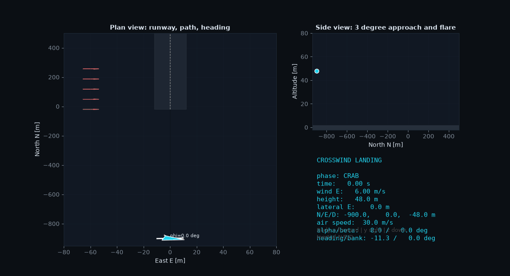

<div align="center">
  <!-- Header Banner -->
  

  <!-- Animated Typing Subtitle -->
  

  <br/><br/>

  <!-- Badges -->
  <p align="center">
    
    
    
    
    
  </p>
</div>

---

## 📽️ Interactive Simulation Preview

<div align="center">
  
  <p><i>Real-time dual-view visualization showing runway planform alignment, approach profile, and live telemetry HUD.</i></p>
</div>

---

## 📌 Executive Summary

The **6-DOF Crosswind Landing Simulation Engine** is a high-fidelity flight dynamics framework developed in Python to simulate light aircraft final approach, de-crab alignment, and touchdown flare under variable crosswind conditions.

The framework models full rigid-body dynamic coupling, aerodynamic load derivatives, rotational quaternion kinematics, and a multi-phase closed-loop flight control system designed to satisfy strict civil aviation touchdown safety envelopes.

---

## 📐 Mathematical & Physics Framework

### 1. 6-DOF Rigid-Body Equations of Motion (Body Frame $\mathcal{F}_b$)
Translational acceleration and rotational rates are integrated using a fixed-step 4th-Order Runge-Kutta (**RK4**) algorithm:

$$\begin{bmatrix} \dot{u} \\  \dot{v} \\  \dot{w} \end{bmatrix} = \frac{1}{m} \mathbf{F}_b - \begin{bmatrix} 0 & -r & q \\  r & 0 & -p \\  -q & p & 0 \end{bmatrix} \begin{bmatrix} u \\  v \\  w \end{bmatrix}$$

$$\begin{bmatrix} \dot{p} \\  \dot{q} \\  \dot{r} \end{bmatrix} = \mathbf{I}^{-1} \left( \mathbf{M}_b - \boldsymbol{\omega}_b \times (\mathbf{I} \boldsymbol{\omega}_b) \right)$$

### 2. Quaternion Kinematics (Gimbal Lock Elimination)
Attitude propagation utilizes unit quaternions $\mathbf{q} = [q_0, q_1, q_2, q_3]^T$ to prevent numerical singularities during large Euler angle transitions:

$$\dot{\mathbf{q}} = \frac{1}{2} \mathbf{q} \otimes \begin{bmatrix} 0 \\  p \\  q \\  r \end{bmatrix}$$

### 3. Non-Linear Trim State Equilibrium Solver
Initial approach trim conditions $(\alpha_0, \delta_{e,0}, \delta_{t,0})$ are computed using `scipy.optimize.least_squares` by enforcing state derivative residual minimization:

$$\mathbf{f}(\mathbf{x}, \mathbf{u}) = \begin{bmatrix} \frac{\sum F_x}{W} \\ \frac{\sum F_z}{W} \\ \frac{\sum M_y}{W \cdot \bar{c}} \end{bmatrix}^T \to \mathbf{0}$$

---

## 🕹️ Multi-Phase Guidance State Machine

The closed-loop guidance architecture transitions automatically across four altitude-dependent operational phases:

```text
[ CRAB PHASE ] ──────> [ DE-CRAB / WING-LOW ] ──────> [ FLARE PHASE ] ──────> [ TOUCHDOWN ]
Altitude > 15m           15m >= Altitude > 8m          8m >= Altitude > 0m         Altitude = 0m
Crab angle heading       Rudder aligns heading         Elevator pitch flare        Ground friction &
compensates crosswind.   with runway centerline.       minimizes sink rate.        rollout deceleration.